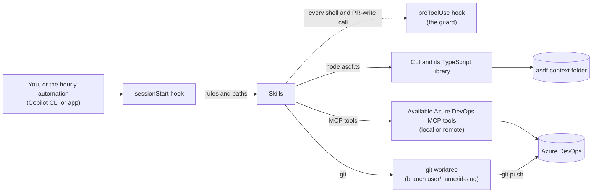
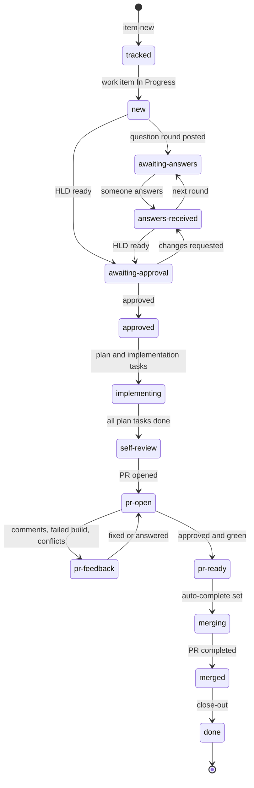
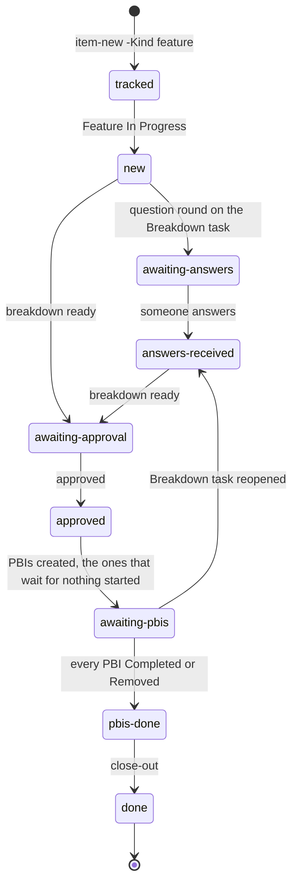
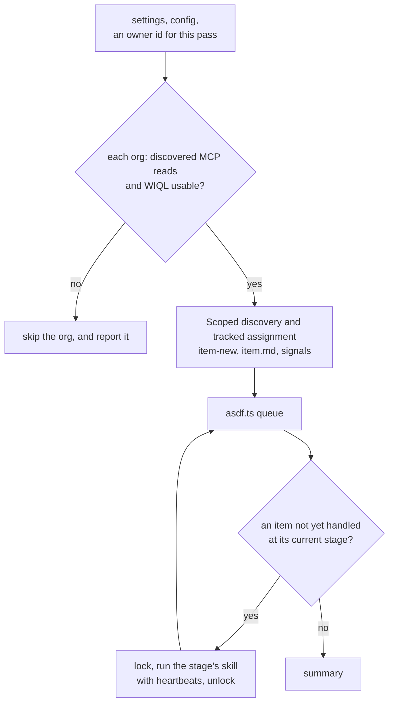

# ASDF architecture

This document is for people who change ASDF (Automated Software Development Workflow). It explains how the plugin fits together: the flow a work item goes through, the hooks, the skills, the scripts, and where state lives. For what ASDF does and how to use it, start with the [README](README.md).

## Overview

ASDF is a GitHub Copilot plugin with three kinds of parts:

| Part | Where | Role |
|---|---|---|
| Skills | `skills/<name>/SKILL.md` | Judgment, and every Azure DevOps (ADO) read and write. The agent follows them. |
| Scripts | [`scripts/asdf.ts`](scripts/asdf.ts) and `scripts/lib/*.ts` | Everything with one right answer: settings and workspaces, item state and stages, approval detection, locks, the work queue, repo-skill discovery, the SDD folder and the guard rules. TypeScript that Node runs directly, with tests on Node's built-in test runner. |
| Hooks | [`hooks/hooks.json`](hooks/hooks.json) | `sessionStart` loads ASDF's rules into every session. `preToolUse` blocks what ASDF must never do. |

A step that needs judgment, or talks to ADO, belongs in a skill. A step with one right answer belongs in TypeScript behind the CLI: which stage comes next, whether a comment approves the HLD, which item to work on first. Skills never edit item state directly; they call the CLI.



Five constraints shape the design:

- **ADO is reached only through the Azure DevOps MCP server**. Skills discover
  available tools at runtime by capability and verify the target org/project;
  one server may serve several orgs. Saved `mcpServer` values are optional
  preference hints, not fixed prefixes. Never use `az` CLI or REST calls; the
  guard blocks both. Code moves with `git`.
- **Nothing ASDF writes goes into the product repo** except code on its `user/<userName>/<id>-<slug>` branches. Designs, plans, questions, decisions, reviews and state live in asdf-context; code worktrees use the separately configured short parent folder.
- **ASDF never searches the disk for code.** An item's code is in one of the workspaces (local checkouts) listed at init. The work item names its package, and ASDF matches it to a workspace.
- **Unattended runs retain host permissions.** Required approvals must be configured through normal host controls; the guard hook is supplementary, not a sandbox or permission bypass. Unattended skills never call `ask_user`; questions go to ADO as comments.
- **ASDF acts under your identity** in ADO and git. Every comment it posts starts with `[ASDF]`, and that marker is how the signal rules tell its comments from people's.

## The flow

### Live interactive continuation

[`live-continuation`](skills/live-continuation/SKILL.md) drives the originating
manual conversation through design and PR waits using the host's recurring
prompt capability (five minutes). It does not launch a CLI worker or contain
its own ADO client. [`work-item`](skills/work-item/SKILL.md) remains the shared
stage table, with explicit live, unattended inline and persistent origins.

| Module | Role |
|---|---|
| [approval.ts](scripts/lib/approval.ts) | Design target identity and pending-feedback guards shared by all modes. |
| [liveWatch.ts](scripts/lib/liveWatch.ts) | Validated item-local live-watch records and 15-minute reservation eligibility. |
| [liveContinuation.ts](scripts/lib/liveContinuation.ts) | Owner-checked lifecycle, interaction receipts, publication and sequential child selection. |

`live-prepare`, `live-bind`, `live-enter`, `live-finish`, `live-suspend`,
`live-stop` and read-only `live-info` expose the watch lifecycle. `live-interaction`
records version-bound chat input, `live-recorded` binds confirmed ADO comment
receipts, and `live-child` chooses from a complete refreshed child snapshot.
`design-feedback-info` recovers interrupted feedback receipts under current
ownership; `design-feedback-recorded` reconciles confirmed ADO comments without
requiring the retired live key; `design-feedback-consume` records how the
feedback was incorporated or forwarded. `design-role` records the currently
observed owned/shared design driver without discarding ownership history.
`design-request-check` preflights publication before external effects, and
`design-request` rechecks and publishes a newer approval cutoff. Neither
publication nor background approval may discard unconsumed feedback.
Host schedule creation/
cancellation and ADO calls stay in the skill. No local file claims a timer
exists without a successful host bind.

Interrupted checks/arming recover through normal operation-lock acquisition,
never by overriding a fresh owner or persistent worker claim. Restoration
reconciles the exact host prompt before reusing or replacing a timer; terminal
items cancel their own monitor even when another operation holds item state.

Success renews waiting priority; read failure preserves its previous deadline.
Fresh operation locks protect actual actions; stale generations cannot reenter.
Worker claims are never overridden. Setup and ordinary acquisition defer
unexpired live reservations; expired/stopped metadata alone does not create
a permanent lock. Pending feedback remains durable across takeover, while
nonowning shared-design waiters do not gain publication rights.

### Automation decision log

[`automationLog.ts`](scripts/lib/automationLog.ts) implements the small
`automation-log` CLI command. It appends bounded, escaped plain-text events
to UTC daily `automation-YYYY-MM-DD.log` files at the context root, with a
short dedicated guard around append/prune. Only regular, non-link files with
the exact valid dated filename are eligible for retention cleanup; an entire
day must be older than five elapsed days.

The coordinator logs discovery/selection and pass completion; the shared item
router logs observed phase outcomes using the same pass ID. This does not trace
all CLI calls or duplicate session transcripts. Idle passes have one summary.
The JSON command result distinguishes append success from cleanup warnings;
append failure exits nonzero, but callers treat it as observation-only and do
not change workflow state, approvals or permissions.

### Manual local setup

[`asdf.js`](asdf.js) dispatches `--init` to the deterministic numbered wizard.
It is not a skill and never invokes a model, MCP server, login or ADO request.
Other arguments retain the existing JSON CLI behavior.
MCP preparation is a review-menu opt-in, not a required section. Default setup
neither reads nor snapshots `mcp-config.json`; unrelated external MCP edits
cannot invalidate that draft. `loadSetupMcp` loads/snapshots it only on explicit
opt-in, retaining concurrency and rollback checks for approved edits.

| Module | Responsibility |
|---|---|
| [watchScopes.ts](scripts/lib/watchScopes.ts) | Typed explicit project/team scopes, v2 config normalization and validation. |
| [setupInputs.ts](scripts/lib/setupInputs.ts) | Local URL/identity parsing and existing checkout validation. |
| [localState.ts](scripts/lib/localState.ts) | Shared atomic file primitives and owner-marked short directory guards. |
| [setupState.ts](scripts/lib/setupState.ts) | Draft/snapshots, approved local MCP edits, dependency checks and conditional rollback. |
| [setupPrompt.ts](scripts/lib/setupPrompt.ts) | Line-oriented terminal IO, cancellation and concrete input examples. |
| [setup.ts](scripts/lib/setup.ts) | Add/Edit/Remove collection loops, Add-another prompts and final review/save. |
| [discovery.ts](scripts/lib/discovery.ts) | Escaped scoped discovery queries, independent assignment queries and paging validation. |
| [worktreePaths.ts](scripts/lib/worktreePaths.ts) | `worktree-path` reserves a short item path under init-selected worktreeRoot; verifies nonoverlap with source/artifacts/other items. |
| [sourceBranch.ts](scripts/lib/sourceBranch.ts) | Validated source-checkout fallback after worktree initialization failure; preserves branches, requires clean checkouts and reserves the source for one item. |

Only numeric config `schemaVersion: 2` is supported; other versions are rejected.
Projects require explicit `watchScopes`; empty means no discovery. Custom
`workItemTypes` require `parent`, `task` and `feature` lists without legacy migration.
Code workspaces and watch sources are independent. A repository registration
does not imply a project-wide watch or a default mapping from backlog to repo.

Setup writes only after review/confirmation. A settings-scoped guard serializes
save with item creation, lock acquisition and short state mutations, always
before an item guard. Active/unresolved operations and disruptive changes to
unfinished context/checkout/branch dependencies block saving, not running work.
Existing JSON CLI setters remain available for programmatic callers.
Org configuration and worker requests accept an absent `mcpServer` while still
validating any supplied hint. Old requests/configs retain their values without
forcing local entry creation. The Node runner does not check host MCP access;
each worker skill discovers its own tools when needed. Skills verify relevant
reads before writes, try existing alternative candidates on read/access failure,
and reconcile uncertain write outcomes rather than replaying them on another
server. Actual inaccessible operations report their target/capability/error.

`discovery-sources` enumerates explicit watches; `discovery-query` verifies the
source snapshot/index and generates its escaped query. `assignment-query`
checks tracked IDs independently of discovery filters. `query-page` validates
ascending ID pages and returns a continuation cursor; these helpers perform
no network calls. Skills execute the returned queries through ADO MCP.

### Persistent CLI workers

`do-next sessions` uses [asdf-worker.ts](scripts/asdf-worker.ts), an asynchronous
Node entry point separate from the synchronous ASDF CLI. Bare do-next keeps
inline execution. Both modes share [work-item](skills/work-item/SKILL.md) for
single-item stage routing, rather than duplicating ADO decisions in Node.

| Module | Responsibility |
|---|---|
| [artifacts.ts](scripts/lib/artifacts.ts) | Item-local physical path containment, atomic sidecar writes and record primitives. |
| [workerLease.ts](scripts/lib/workerLease.ts) | Short serialized operation guard and unfinished-worker ownership claim. |
| [sessions.ts](scripts/lib/sessions.ts) | Typed binding/run/request records, acknowledgement and explicit recovery. |
| [copilotProcess.ts](scripts/lib/copilotProcess.ts) | Shell-free installed CLI resolution, create/resume arguments and streaming JSONL capture. |
| [worker.ts](scripts/lib/worker.ts) | Per-item runner lifecycle, timer renewal, exact session identity and completion validation. |
| [sessionStatus.ts](scripts/lib/sessionStatus.ts) | Read-only current status, ADO wait targets and transcript promotion. |

`queue-report` exposes healthy candidates and ownership diagnostics.
`worker-request` validates the current dispatch; `worker-complete` records a
typed acknowledgement; `worker-fail` reports infrastructure failure without
changing the business stage. `session-info` is read-only. `session-recover`
requires an explicit stopped-run identity and reason to retry or replace
history. Unknown/interrupted lifetime additionally requires the operator's
`-ProcessesStopped true` acknowledgement after inspecting descendants, plus
same-host/dead-PID checks. Automation cannot provide this acknowledgement.

Sidecars live in `<item>\session\`, outside the code worktree. Copilot owns its
native session storage. ASDF reserves the UUID before creation and resumes by
exact ID, never by name/most-recent. The Node runner owns lock release; stage
skills and subagents retain the same owner. A normal CLI exit without a
matching acknowledgement is incomplete. Uncertain termination keeps the
claim and blocks competing sync/live/worker operations.

The stable artifact cwd survives worktree removal. Code workers still use the
verified execution packet and explicit worktree cwd. Transcripts/status are
for observation; no human takeover or guaranteed native desktop registration
is provided. Infrastructure and observation failures remain distinct from
ADO business blockers, and existing approval/merge rules are unchanged.

### Entry points

| You run | Skill | What happens |
|---|---|---|
| `node asdf.js --init` in a terminal | [Manual wizard](scripts/lib/setup.ts) | Local-only context/config/MCP preparation with examples and repeated individual entries. |
| "work on PBI 12345" | [`intake`](skills/intake/SKILL.md) | Gets the work item, creates its folder, and routes it. A PBI or User Story gets a size check first, and a large one can become a Feature. |
| "work on Feature 4120" | [`intake`](skills/intake/SKILL.md), then [`feature-breakdown`](skills/feature-breakdown/SKILL.md) | Breaks the Feature into PBIs, each with its own HLD and PR. |
| `/asdf:do-next`, by hand or from an hourly automation | [`do-next`](skills/do-next/SKILL.md) | One pass over every tracked item. |
| "let's go through the open questions for 12345" | [`brainstorming`](skills/brainstorming/SKILL.md) | Answers a question round in a live session. |

Every session also gets [`using-asdf`](skills/using-asdf/SKILL.md) from the sessionStart hook: the rules, and which skill to use when.

### Which repo

- **Matching.** The work item names its package, for example `Payments`. `brainstorming` (for a parent) or Task routing in `intake` (for a Task) matches it to a workspace with `asdf.ts item-repo`.
- **What gets recorded.** `item-repo` saves the repo's org, project and name, and the workspace's path, on the item.
- **No match.** If the work item names no package that has a workspace, ASDF asks. For a parent, that's question 1 of the first HLD round; for a Task, a blocker comment.
- **Pull requests** are made in that repo's project, which can differ from the work item's.

### Stages

Every tracked work item has a folder in the asdf-context, and its `state.json` holds exactly one stage. Stages change in two ways:

- **Signals.** `do-next` reads ADO (work item states, HLD-task comments, PR state), writes what it read to a signals file, and runs `asdf.ts signals`. Fixed rules turn that into a stage change. This is how people's actions reach ASDF: moving a PBI to In Progress, answering, approving, reviewing.
- **Skills.** A skill runs `asdf.ts stage` when it finishes its step.

The main path:



Off the main path:

- **`blocked`**: a skill can't go on. It posts a `blocker` comment, then runs `stage blocked -Reason`, which records when the item was blocked. A person's reply after that returns the item to the stage it left.
- **`paused`**: the governing work item is no longer active. It was closed, it's no longer assigned to you, or it moved back out of In Progress.
  - A parent item governs itself.
  - A Task under a parent is governed by the parent, unless the Task itself is closed or removed.
  - A Task without a parent governs itself, and counts as active from its first state.

  When the governing item is active again, the item returns to the stage it left. An item paused while its PR is open or merging still goes to `merged` when the PR completes, and gets the normal close-out.
- **`awaiting-parent`**: a complex Task with no parent waits until someone parents it.
- **A reopened HLD**: reopening an HLD task that ASDF closed sends any stage from `approved` to `pr-ready` back to `answers-received`. Once auto-complete is set (`merging`), the PR is left to merge.
- **A small Task** goes from `new` straight to `implementing`: TDD with no HLD and no plan, then the normal review and PR path.

#### A Feature's path

A Feature (kind `feature`) is never built itself. [`feature-breakdown`](skills/feature-breakdown/SKILL.md) breaks it into PBIs, and each PBI then takes the main path on its own.



- **The design task** of a Feature is its Breakdown task, kept in the same fields as an HLD task (`ado.hldId`, `hld.*`), so the round and approval rules apply unchanged.
- **The PBIs** are recorded in `ado.pbis`, each with the PBIs it waits for. A PBI that waits for another stays Proposed until a person starts it; `signals` reports it as `ready` once what it waits for is Completed, and `do-next` lists it in its summary.
- **A large PBI** can become a Feature before its design starts: `intake` asks in a session, and `brainstorming` asks in the first round. On a yes, the PBI is parked at `tracked` (Proposed in ADO) until the breakdown is approved, and its `size` is `phase`.

### Who handles each stage

`do-next` works the stages that have a queue priority, lowest number first (`STAGE_PRIORITY` in [`items.ts`](scripts/lib/items.ts)). The other stages wait for a person or for ADO, and only the signal rules move them on.

| Stage | Waiting for | Priority | Handled by | Usually moves to |
|---|---|---|---|---|
| `tracked` | the work item to reach In Progress | — | signals | `new` |
| `awaiting-parent` | someone to parent the Task | — | signals | `new` |
| `new` | — | 6 | `brainstorming` (a parent); Task routing in `intake` (a Task); `feature-breakdown` (a Feature) | `awaiting-answers`, `awaiting-approval`, `implementing`, `tracked` (a PBI made into a Feature) |
| `awaiting-answers` | answers on the design task | — | signals | `answers-received` |
| `answers-received` | — | 5 | `brainstorming`; `feature-breakdown` (a Feature) | `awaiting-answers`, `awaiting-approval` |
| `awaiting-approval` | approval of the HLD or breakdown | — | signals | `approved`, `answers-received` |
| `approved` | — | 4 | `writing-plans`; `feature-breakdown` (a Feature: creates its PBIs) | `implementing`, `awaiting-pbis` |
| `awaiting-pbis` | a Feature's PBIs to finish | — | signals | `pbis-done`, `answers-received` |
| `pbis-done` | — | 2 | `feature-breakdown` (close out the Feature) | `done` |
| `implementing` | — | 3 | `subagent-driven-development` (or `executing-plans`); TDD for a small Task | `self-review` |
| `self-review` | — | 3 | `requesting-code-review`, then `finishing-a-development-branch` | `pr-open` |
| `pr-open` | reviewers and the build | — | signals | `pr-feedback`, `pr-ready`, `merged` |
| `pr-feedback` | — | 1 | `receiving-code-review` | `pr-open` |
| `pr-ready` | — | 2 | `finishing-a-development-branch` (merge) | `merging` |
| `merging` | ADO to complete the PR | — | signals | `merged`, `pr-feedback` |
| `merged` | — | 2 | `finishing-a-development-branch` (close out) | `done` |
| `done` | — | — | — | — |
| `blocked` | a reply to the blocker | — | signals | the stage it left |
| `paused` | the work item to be active again | — | signals | the stage it left |

### The signal rules

`getTransition` in [`signals.ts`](scripts/lib/signals.ts) is a pure function of an item's state and a signals object. The first rule that matches wins:

1. `done`, `merged` and `pbis-done` never move.
2. Any item with `ado.prId` and a completed PR goes to `merged`, even from feedback, ready, blocked, paused or design-revision stages, and even if the work item was closed or reassigned. Legacy PR stages also recognize completion without a recorded id. A blocker raised during close-out (`resumeStage: merged`) instead waits for a reply, even after the governing item closes; repeated PR completion must not retry that failure every pass.
3. If the governing work item is inactive, the item goes to `paused` (from any stage except `tracked`, `awaiting-parent` and `paused`). A `paused` item goes back to `resumeStage` once it's active again. A `tracked` item whose work item is active goes to `new`.
4. `awaiting-parent` pauses if reassigned, Completed or Removed. Otherwise a parent moves it to `new` if active, or `tracked` if inactive.
5. `awaiting-answers` with a human comment newer than `hld.roundPostedAt` goes to `answers-received`.
6. `awaiting-approval` accepts a fresh design-task Completed transition unless
   later human feedback supersedes it, or an unconditional latest approval
   comment after `hld.approvalRequestedAt`. Accepted comments are `approved`
   or `approved, ship it` with optional `.`/`!`; conditions/changes require
   revision. Accepted pending feedback gates advancement until a newer request
   is published. Feature self-ID fallback cannot approve by Feature completion.
7. Any stage from `approved` to `pr-ready`, and a Feature at `awaiting-pbis`, goes to `answers-received` if its design task, closed by ASDF (`hld.closedAt`), is back in Proposed or InProgress. The reason is `HLD reopened`, or `breakdown reopened` for a Feature.
8. `awaiting-pbis` goes to `pbis-done` when the signals list the Feature's PBIs and every one is Completed or Removed.
9. An abandoned PR blocks an eligible item with a PR, including `pr-feedback` and `pr-ready`, without repeatedly resetting an existing blocker. For `pr-open` or `merging`:
   - an active thread whose last comment is a person's, a failed build, or a merge conflict goes to `pr-feedback`;
   - from `pr-open`, approved and green with no active thread goes to `pr-ready`.
10. `blocked` with a human comment on the blocker's work item, newer than `blocker.commentAt`, goes back to `resumeStage`.

A *human comment* is one whose plain text doesn't start with `[ASDF]`. Plain text means HTML stripped, `@mention` anchors removed and entities decoded. `invokeSignals` applies the result. With `-Owner`, it first verifies/heartbeats that owner's lock; without it, it skips locked items for compatibility. For a Feature at `awaiting-pbis`, it also returns `ready` from `readyPbis`: the PBIs still Proposed whose every prerequisite is Completed.

Flags that `do-next` writes by hand (`assignedToMe`, `lastCommentIsAsdf`, `mergeConflicts`, `approved`) are read leniently: booleans, `1` and `0`, and the text `true` and `false` in any case.

### A do-next pass



1. **Check.** `asdf.ts settings` and `config`, and one owner id for every lock this pass takes.
2. **Reach each org.** Discover work-item/WIQL tools in the running host; use saved
   hints only as preferences and verify target identity through required reads.
   Skip/report only when no candidate can perform the operation. Its items stay untouched.
3. **Sync.**
   - Paginated queries discover open assigned work from explicit project/team scopes, leaving out ASDF's own tasks (tag `asdf`). Failed scopes are reported, not widened.
   - Separate paginated queries for tracked IDs determine assignment without team/area/type/tag/completed filters, including projects without watches. An incomplete/failed batch is unknown and its items receive no signals or work that pass.
   - Classify Features and PBIs before Tasks. New ids get `item-new`, which refuses design tasks and unstarted children governed by a tracked, nonpaused, unfinished PBI in the same org. Existing standalone work retains its workflow/PR; the parent must not plan overlapping work. Numeric ids that another org already tracks still report a collision.
   - Acquire each item's lock before refreshing its snapshot or signals file; skip held items without overwriting their context.
   - Apply `signals -Owner <pass owner>`, then release the sync lock.
4. **Work the queue.** Exclude items whose necessary reads failed. Inline mode locks and invokes the shared item router; sessions mode invokes the Node worker. A pass handles an item at most once per stage. Business failures use the blocker flow; infrastructure failures are reported without changing business state. Lost ownership stops further writes.
5. **Summarize** what moved, what's blocked, what's waiting on people, and which orgs were skipped.

Live sessions use the same item-operation lock protocol as hourly passes, retain their owner across handoffs, and heartbeat after user waits before recording answers. `queue` skips locked and managed-child items. Lock stale takeover remains the existing `lockStaleMinutes` mechanism (90 by default).

### Work items and comments in ADO

- **At pickup,** ASDF creates an HLD task and a Review task under the parent. A Feature gets only a Breakdown task (`Breakdown: <feature title>`, tag `asdf-breakdown`).
- **After approval,** it creates one implementation task per plan step. On the Task path, the Task itself is the implementation task. After a Feature's breakdown is approved, it creates the PBIs the breakdown lists: ordinary PBIs with no ASDF tags, so the assigned-items query finds them.
- **A Feature,** with the person's OK, when a large PBI becomes one. The PBI goes under it.
- **Tags and assignee.** ASDF's tasks are tagged `asdf`, plus `asdf-hld`, `asdf-review`, `asdf-impl` or `asdf-breakdown`, and assigned to the parent's assignee.
- **An existing HLD task** on the parent is adopted instead of creating a second one, and so is an existing Breakdown task on a Feature. `ado.hldOwned` records whether this item created, or drives, its design task. ASDF only closes or reopens design tasks it owns.
- **Comments.** Every comment comes from a template in [`templates.md`](skills/ado-work-items/templates.md) and starts with `[ASDF]`.
- **The HLD on the task.** The HLD is uploaded as `hld.v<N>.md`, and the HLD task's description holds the decisions table.
- **The PR** is created from the item's branch, `user/<userName>/<id>-<slug>`, with a description from [`pr-description-template.md`](skills/finishing-a-development-branch/pr-description-template.md). ASDF merges it by setting auto-complete once its own checks pass. It never votes, never bypasses a policy, and never merges locally.

## Hooks

[`hooks/hooks.json`](hooks/hooks.json) uses Copilot's hook format (version 1). Both hooks are TypeScript files that the hook command runs with `node` (from PowerShell on Windows, bash elsewhere), with `ASDF_PLUGIN_ROOT` set to the plugin root (`${PLUGIN_ROOT}`). Each hook loads the library with a dynamic `import()` inside a `try`, so even a broken install can't fail a session or block a tool.

| Hook | Script | Timeout | Runs |
|---|---|---|---|
| `sessionStart` | [`hooks/session-start.ts`](hooks/session-start.ts) | 30 s | at the start of every session |
| `preToolUse` | [`hooks/guard.ts`](hooks/guard.ts) | 15 s | before each call to a tool its matcher selects |

### sessionStart: the bootstrap

`session-start.ts` prints one JSON object, `{"additionalContext": "..."}`, which Copilot adds to the session. The text is:

```
ASDF is active.
ASDF plugin root: <root>
ASDF CLI: node "<root>/scripts/asdf.ts" <command>
asdf-context: <path>

<the body of skills/using-asdf/SKILL.md>
```

When ASDF isn't set up, the context tells the user to run `node "<resolved plugin root>\asdf.js" --init` manually. The `ASDF setup` line always supplies that command. Skills take the CLI path and context folder from the bootstrap and write `asdf.ts <command>` as shorthand. Missing/unreadable settings report "not initialized"; the hook never starts setup and always exits 0.

### preToolUse: the guard

[`hooks/guard.ts`](hooks/guard.ts) reads the tool call from stdin and asks `guardDecision` in [`scripts/lib/guard.ts`](scripts/lib/guard.ts). To block the call, it prints `{"permissionDecision":"deny","permissionDecisionReason":"ASDF guard: ..."}`. Copilot runs the hook before its permission check, so a deny stands even in runs that approve every tool.

The matcher (`powershell|bash|.*repo_pull_request_write|.*start_process|.*interact_with_process`) sends it three kinds of tool call:

- the shell tools;
- MCP tools that run processes, such as Desktop Commander's;
- the ADO PR write tool.

It denies:

- `git push` with any of these:
  - `--force` or `--force-with-lease`;
  - `-f`, alone or inside combined flags;
  - a `+` refspec;
  - `--mirror` or `--all`;
  - a destination of `main` or `master`, including their `refs/heads/` forms;
  - once init has saved a user name: a destination outside `user/<userName>/` (including `HEAD`), or no destination at all (a bare `git push`), because the guard can't see which branch those reach. Pushing tags is fine;
- `az devops`, `az boards`, `az repos`, `az pipelines` and `az artifacts`;
- an HTTP client (`Invoke-RestMethod`, `Invoke-WebRequest`, `irm`, `iwr`, `curl`, `wget`, `WebClient`, `HttpClient`, `az rest`) in a command that names `dev.azure.com` or `*.visualstudio.com`;
- `repo_pull_request_write` with `action` set to `vote`, and any call that sets `bypassPolicy` to anything but false;
- the self-test token `ASDF-GUARD-SELFTEST`.

Before the git check, a command given as a list of words is joined with spaces, and commands are split on `&&`, `||`, `;`, `|` and newlines, so `cd x; git push origin main` is caught.

The guard **fails open**. If it hits an error itself, such as input it can't parse, it allows the call and logs the error to `asdf-hooks.log` in the temp folder (or to `ASDF_HOOK_LOG`). A broken guard must never block every shell command in every session. To stay fast, the hook loads only `guard.ts`, which is pure, plus `settings.ts` to read the user name from `asdf.config.json`, not the whole CLI. Until init saves a user name, the branch-prefix rule is off.

## Skills

A skill is invoked as `asdf:<name>`, where `<name>` is its folder. Its frontmatter `name` matches the folder, and Copilot decides when to load it from its `description`, which starts with "Use when".

| Skill | Role | Origin |
|---|---|---|
| [`using-asdf`](skills/using-asdf/SKILL.md) | The bootstrap: ASDF's rules, and which skill to use when. Injected into every session. | Adapted (from `using-superpowers`) |
| [`intake`](skills/intake/SKILL.md) | The entry point for session work: finds the work item, creates its folder, routes it. Owns Task routing: small, or complex with or without a parent. | ASDF |
| [`do-next`](skills/do-next/SKILL.md) | One unattended pass: sync, signals, then the queue, most-finished work first. Never asks. | ASDF |
| [`ado-work-items`](skills/ado-work-items/SKILL.md) | Every ADO convention: MCP tools, the WIQL, states by category, task titles and tags, comments, the signals recipe. [`templates.md`](skills/ado-work-items/templates.md) holds every comment. | ASDF |
| [`brainstorming`](skills/brainstorming/SKILL.md) | The HLD. Does the deep dive into the code, drafts the HLD, asks question rounds, records decisions with provenance, runs the [builder check](skills/brainstorming/builder-check-prompt.md) and the [code check](skills/brainstorming/code-check-prompt.md), and requests approval. | Adapted |
| [`feature-breakdown`](skills/feature-breakdown/SKILL.md) | Breaks a Feature into PBIs: its requirements, and the PBIs in order, with question rounds and approval on a Breakdown task and a [breakdown check](skills/feature-breakdown/breakdown-check-prompt.md). Creates the PBIs, and closes the Feature once they're finished. Also makes a large PBI into a Feature. | ASDF |
| [`writing-plans`](skills/writing-plans/SKILL.md) | After approval: `plan.md`, planning decisions (`P<n>`) and the implementation tasks. | Adapted |
| [`using-git-worktrees`](skills/using-git-worktrees/SKILL.md) | The item's recorded worktree, on its branch (`repo.branch`), made from its workspace under the init-selected short root. Runs baseline build/test. | Adapted |
| [`subagent-driven-development`](skills/subagent-driven-development/SKILL.md) | Implements the plan: a fresh implementer subagent per task and a review after each. Uses the [implementer](skills/subagent-driven-development/implementer-prompt.md), [task reviewer](skills/subagent-driven-development/task-reviewer-prompt.md) and [re-review](skills/subagent-driven-development/re-review-prompt.md) prompts. | Adapted |
| [`executing-plans`](skills/executing-plans/SKILL.md) | The same, inline, when subagents can't be dispatched. | Adapted |
| [`test-driven-development`](skills/test-driven-development/SKILL.md) | Every code change starts with a failing test. | Copied |
| [`systematic-debugging`](skills/systematic-debugging/SKILL.md) | Root cause before any fix. Includes [`find-polluter.ts`](skills/systematic-debugging/find-polluter.ts), a TypeScript port of the upstream script. | Copied |
| [`verification-before-completion`](skills/verification-before-completion/SKILL.md) | Evidence before any claim that something is done. | Copied |
| [`requesting-code-review`](skills/requesting-code-review/SKILL.md) | The Review task. Runs the ASDF reviewer ([`code-reviewer.md`](skills/requesting-code-review/code-reviewer.md)) and every review skill the repo provides, then fixes or declines each finding. | Adapted |
| [`receiving-code-review`](skills/receiving-code-review/SKILL.md) | PR feedback: fixes or answers each human thread, failed build and merge conflict. | Adapted |
| [`finishing-a-development-branch`](skills/finishing-a-development-branch/SKILL.md) | Three modes, chosen by stage: open the PR; merge through auto-complete; close out (tasks, as-built notes, memory index, cleanup). | Adapted |
| [`dispatching-parallel-agents`](skills/dispatching-parallel-agents/SKILL.md) | Runs independent investigations in parallel. | Copied |
| [`writing-skills`](skills/writing-skills/SKILL.md) | How to change ASDF's own skills, test first. | Copied |

*Copied* means copied from Superpowers 7.0.0 with small edits. *Adapted* means rewritten for ASDF from the Superpowers skill of the same name. *ASDF* means written new.

How the skills fit together:

- **Paths come from the session context:** the CLI line and the `asdf-context` line from the sessionStart hook. Skills don't guess paths.
- **Upstream engine skills start with an ASDF section** ("ASDF overlay", "ASDF: before you write", "ASDF: PR feedback"). It overrides the upstream text for unattended work:
  - post a blocker instead of asking;
  - use the item's `sdd\` folder;
  - treat the Review task as the final review.
- **Any skill that can't go on** posts the `blocker` comment and runs `stage blocked -Reason`.
- **`decisions.md` holds every decision.**
  - `D<n>` rows are design decisions. Each is either decided by a person, or an ASDF assumption approved with the HLD.
  - `P<n>` rows are ASDF's planning decisions after approval. They're listed in the PR description.
- **Every design stands on a deep dive.**
  - Before drafting, `brainstorming` writes `deep-dive.md`: how the code works today, what can be reused, what depends on what will change, and the edge cases, each with a file and line. `feature-breakdown` writes one at the Feature's breadth.
  - The HLD's Reuse, What must keep working and Edge cases sections come from it.
  - The code check tests the HLD against the code before approval. `writing-plans` gives each must-keep-working and edge-case entry a test, and the self-review searches for every caller.
- **Rules that must not drift** are pinned as sentences that each skill must contain verbatim, in [`tests/skill-rules.json`](tests/skill-rules.json).

## Scripts

### The CLI

[`scripts/asdf.ts`](scripts/asdf.ts) is how skills read and change ASDF state. Skills write it as `asdf.ts <command>`, short for the CLI line in the session context:

```
node "<plugin root>/scripts/asdf.ts" <command> -Name value ...
```

- **Output.** Success prints JSON on stdout and exits 0. Errors print `{"error":"ASDF_<CODE>","message":"..."}` and exit 1. An unexpected exception becomes `ASDF_INTERNAL`. `task-done` preserves its `{exitCode, log, recorded}` result and propagates a failing test's nonzero exit code; completion requires `recorded: true`.
- **JSON input** goes in a file. `-File <path>` is the JSON input of `config-set`, `item-set` and `signals`.
- **It never prompts.** A missing parameter is `ASDF_MISSING_ARGUMENT`, because an unattended run has nobody to answer a prompt. Parameter names are case-insensitive. An unknown parameter, or a value that should be a whole number and isn't, is `ASDF_BAD_ARGUMENT`.
- **One table.** The command table in [`cli.ts`](scripts/lib/cli.ts) gives each command's parameters and the library function it calls, so a new command or parameter is one entry there.

| Command | Function | What it does |
|---|---|---|
| `settings` | `getSettings` | The settings file's path, whether ASDF is initialized, and the context folder. |
| `settings-set` | `setSettings` | `-ContextPath`: must be absolute and outside every git work tree. Created if missing. |
| `config` | `getConfig` | Reads/normalizes v2 config without writing it. Other versions and missing explicit scopes or custom type lists fail explicitly; no legacy migration. |
| `config-set` | `setConfig` | `-File`: validates the config, fills in defaults, reads each workspace's repo from its git remote, and writes it. |
| `item-new` | `newItem` | `-Org -Project -Id -Kind -Type -Title [-ParentId]`: creates the item folder in `tracked`, with its branch name (none for a Feature). `-Kind` is `parent`, `task` or `feature`. Repeating it is harmless. Refuses another item's own task (`ASDF_OWN_TASK`) and an id another org's item already uses (`ASDF_ID_CLASH`). |
| `item` | `getItem` | `-Id`: the item's state, plus its folder `path`. |
| `items` | `getItems` | Every item, or only those in `-Stage a,b`, each with its `path`. |
| `item-set` | `setItem` | `-Id -File`: deep-merges a JSON patch into `state.json`. Refuses `id`, `stage`, `resumeStage` and `stats`. |
| `item-repo` | `setItemRepo` | `-Id -Name [-Org -Project]`: records the workspace, matched by repo name then folder name within optional identity qualifiers. Ambiguity fails explicitly. |
| `memory-path` | `memoryPath` | `-Org -Project -Repo`: returns the qualified, filesystem-safe memory index path; creates no files. |
| `source-fallback` | `sourceFallback` | `-Id -Owner -BaseRef -Reason`: after a successful fetch, registers the clean configured source checkout on the item branch from origin/main or origin/master; preserves its previous branch/HEAD and any clean detached worktree. Rejects dirty/implemented branches and competing source reservations. |
| `baseline` | `runBaseline` | `-Id -Owner -BuildCommand [-TestCommand]`: runs the repo build then baseline tests in verified codeRoot, retaining baseline.json/log in artifactRoot. A failing build skips tests; failure invalidates prior evidence and exits nonzero. |
| `execution-context` | `executionContext` | `-Id -Owner`: verifies configured repo identity, canonical item checkout, Git registration/common directory, branch and held lock. Source mode also checks reservation and recorded remote-base ancestry. Returns checkoutMode, CLI entry, roots, HEAD and instructions without granting permissions or renewing the lock. |
| `code-path` | `codePath` | `-Id -Owner -Path`: resolves an edit target against the verified code root and returns an absolute path plus applicable directory-instruction files. Rejects escapes, metadata and nested repos. Scoped instruction files remain candidates whose scope must be evaluated by the worker. |
| `stage` | `setItemStage` | `-Id -Stage [-Reason] [-WorkItemId]`: moves the item and records when and why. `blocked` needs `-Reason`, and records the blocker. |
| `signals` | `invokeSignals` | `-Id -File [-Owner]`: applies rules under the supplied owner's lock; otherwise skips locked items. A waiting Feature also returns `ready`. |
| `queue` | `getQueue` | The items `do-next` can work on now, in order. |
| `lock` | `lockItem` | `-Id -Owner`: takes the item's lock, and returns whether it was `acquired`. |
| `heartbeat` | `heartbeat` | `-Id -Owner`: keeps the lock fresh. |
| `unlock` | `unlockItem` | `-Id -Owner`: releases the lock. Only its owner can. |
| `repo-skills` | `findRepoSkills` | `-RepoPath -Kind`: the repo's own skills and agents for `review`, `build`, `test` or `worktree`, including bootstrap/setup guidance in .github, .agents, .claude and .copilot skill folders. |
| `task-brief` | `taskBrief` | `-Id -PlanPath -TaskNumber`: cuts one task from an item-local plan into `sdd\`; rejects a foreign plan path. |
| `task-start` | `taskStart` | `-Id -Owner -PlanPath -TaskNumber -RepoPath`: verifies the item checkout and this operation's passing baseline before producing the brief, base commit and execution context. |
| `task-done` | `taskDone` | `-Id -Owner -TaskNumber -Base -RepoPath -TestCommand`: runs the test in the verified item worktree through the system shell (cmd on Windows, sh elsewhere). Only a pass with context still valid is written to the ledger. |
| `review-package` | `reviewPackage` | `-Id -Owner -RepoPath -Base -Head`: verifies the item worktree and produces commit list, stat and diff. Every Git command must succeed before an artifact is written. |
| `ledger-add` | `ledgerAdd` | `-Id -Text`: appends a timestamped line to the ledger. |

### The library

[`asdf.ts`](scripts/asdf.ts) only runs the CLI. Each file in `scripts/lib/` owns one area:

| File | Owns |
|---|---|
| [`cli.ts`](scripts/lib/cli.ts) | The command table, argument parsing, `-File` input, and the JSON output and errors. |
| [`util.ts`](scripts/lib/util.ts) | Shared helpers: `AsdfError`, JSON files, timestamps, case-insensitive lookups for JSON that others write, and running git. |
| [`settings.ts`](scripts/lib/settings.ts) | The settings file and `asdf.config.json`: paths, validation, defaults (including the `feature` type list), and the branch prefix `user/<userName>`. |
| [`workspaces.ts`](scripts/lib/workspaces.ts) | Reading an Azure DevOps remote URL, and resolving a checkout to its org, project and repo. |
| [`items.ts`](scripts/lib/items.ts) | Item folders and `state.json`: the stage list, queue priorities, slugs, creation, patches, stage changes, blocker bookkeeping, stats, and recording an item's workspace. |
| [`lock.ts`](scripts/lib/lock.ts) | Per-item locks: atomic creation, owner checks, heartbeats and taking over a stale lock. |
| [`execution.ts`](scripts/lib/execution.ts) | Validated per-item execution context, instruction inventory, code-path containment and artifact-path containment. Uses native canonical paths for Windows short-name/junction identity. |
| [`queue.ts`](scripts/lib/queue.ts) | The work queue: unlocked items in stages with a priority, ordered by priority, then time in the stage. |
| [`signals.ts`](scripts/lib/signals.ts) | Reading comments (HTML to text, the `[ASDF]` marker, "approved"), deciding whether the governing item is active, the transition rules, and which of a Feature's PBIs are ready to start. |
| [`repoSkills.ts`](scripts/lib/repoSkills.ts) | Finds a repo's review, build and test skills (under `.github/skills`, `.agents/skills` and `.claude/skills`) and agents (under `.github/agents`). |
| [`sdd.ts`](scripts/lib/sdd.ts) | The SDD folder (`<item>\sdd\`): task briefs, review packages, test runs and the ledger. Ports of Superpowers' workspace scripts. |
| [`guard.ts`](scripts/lib/guard.ts) | The guard rules. Pure, and it imports only `util.ts`, because the guard hook runs before every shell call. |

Conventions:

- **Node runs the TypeScript as is.** Only erasable syntax (no `enum`, `namespace` or parameter properties), imports with their `.ts` extension, and `import type` for types. `npm run typecheck` holds the code to this (`erasableSyntaxOnly` and `verbatimModuleSyntax` in [`tsconfig.json`](tsconfig.json)).
- **No runtime packages.** Only Node's built-in modules, so the plugin needs nothing but Node.
- **Execution paths.** Comparisons use native canonical paths, while `codeRoot` retains the verified recorded path for commands, preserving drive mappings and short-path enlistments. Windows `task-done` rejects UNC cwd rather than allowing cmd to fall back to another directory.
- **Imports run one way:** `util` ← `workspaces` ← `settings` ← `items` ← `lock` ← `queue` and `signals`. `execution` uses those helpers, and `sdd` uses `execution` and `util`; `repoSkills` and `guard` use only `util`; `cli` uses them all.
- **JSON:** timestamps stay strings, written as UTC `yyyy-MM-ddTHH:mm:ssZ`. Names and states from ADO or from people compare case-insensitively.
- **Time:** functions that depend on the time take an optional `now` (the CLI's `-Now`), so tests can fix the clock.
- **Errors:** functions throw an `AsdfError` with its `ASDF_<CODE>`, and the CLI turns that into its JSON error.

| Error | Raised when |
|---|---|
| `ASDF_NOT_INITIALIZED` | There's no settings file yet. Run the manual `node "<plugin root>\asdf.js" --init` command. |
| `ASDF_SETTINGS_INVALID` | The settings file isn't valid JSON. |
| `ASDF_CONTEXT_NOT_ABSOLUTE`, `ASDF_CONTEXT_INSIDE_REPO` | The context folder isn't an absolute path, or is inside a git work tree. |
| `ASDF_CONFIG_INVALID` | `config-set` validation failed, for example a workspace that isn't a git checkout of an Azure DevOps repo. The message gives the first reason. |
| `ASDF_ITEM_NOT_FOUND` | No folder exists for that id. |
| `ASDF_OWN_TASK` | `item-new` was given another item's HLD, Review or implementation task. |
| `ASDF_ID_CLASH` | `item-new` was given an id that another org's item already uses. |
| `ASDF_NO_WORKSPACE` | `item-repo` found no single workspace for the package. The message lists the configured workspaces. |
| `ASDF_PATCH_FORBIDDEN_KEY` | `item-set` tried to change `id`, `stage`, `resumeStage` or `stats`. |
| `ASDF_STAGE_UNKNOWN`, `ASDF_REASON_REQUIRED` | `stage` got an unknown stage, or `blocked` without `-Reason`. |
| `ASDF_LOCK_NOT_OWNER` | `heartbeat` was called on a lock another pass holds. |
| `ASDF_BAD_REF`, `ASDF_TASK_NOT_FOUND` | A git ref doesn't resolve, or the plan has no task with that number. |
| `ASDF_GIT_FAILED` | A Git command failed while generating a review package; no incomplete artifact is returned. |
| `ASDF_EXECUTION_CONTEXT` | The recorded/configured repo, checkout registration, physical slot or branch does not match. Stop rather than switching or choosing an unregistered fallback checkout. |
| `ASDF_SOURCE_FALLBACK` | Source fallback cannot safely create/reuse the item branch at fetched origin/main or origin/master. Preserve user files and branches; block rather than reset. |
| `ASDF_BASELINE_REQUIRED` | Implementation needs a passing baseline for the current operation owner, codeRoot and branch, at an ancestor of current HEAD. Re-run preflight; old-operation or failed evidence is not sufficient. |
| `ASDF_CODE_PATH`, `ASDF_ARTIFACT_PATH` | A code edit or artifact path escapes the item's respective root, crosses into a nested repo, or targets Git metadata. |
| `ASDF_BAD_ARGUMENT`, `ASDF_MISSING_ARGUMENT`, `ASDF_UNKNOWN_COMMAND` | The CLI call is malformed. |
| `ASDF_INTERNAL` | Anything else. |

## State on disk

```
~\.copilot\asdf\settings.json    the context folder's path (the ASDF_SETTINGS environment variable overrides where this file lives)
<asdf-context>\
  asdf.config.json               orgs, optional MCP hints, projects, work item types, workspaces, user name, limits
  memory\org-<org>\project-<project>\repo-<repo>.md
                                one entry per merged item, scoped to the full repository identity
  # The item's code worktree is elsewhere: <worktreeRoot>\<six-character-name>
  <id>-<slug>\                   one folder per work item
    state.json                   stage, ADO ids, HLD times, blocker, stats
    .lock                        present while a pass works on the item
    item.md                      snapshot of the work item
    execution-context.json       refreshed CLI-produced execution packet passed to code workers
    deep-dive.md                 the deep dive into the existing code that the design stands on
    hld.md, hld.v<N>.md          the design, and each version sent for approval
    breakdown.md, breakdown.v<N>.md   a Feature's breakdown into PBIs, and each version sent for approval
    questions.md, decisions.md   question rounds, and every decision with its provenance
    plan.md                      the implementation plan (earlier plans: plan.v<k>.md)
    diagrams\, reviews\          design diagrams and self-review reports
    sdd\                         ledger.md, task briefs, review packages, test logs
    patch.json, signals.json     inputs for item-set and signals
```

| File | Written by |
|---|---|
| `settings.json`, `asdf.config.json` | Manual guided setup with confirmed local save; programmatic `settings-set` and `config-set` remain compatible |
| `state.json`, `.lock` | the CLI only |
| `item.md` | `intake` and `do-next` |
| `execution-context.json` | The controller saves `execution-context` output after worktree setup and refreshes it before dispatch/resume. Workers revalidate; it is not a host permission grant. |
| `baseline.json`, `baseline.log` | `baseline` records the actual build/test commands, owner, codeRoot, branch, HEAD and result before implementation. Failed retries invalidate prior passes. Implementation code-path, task-start and task-done require current evidence; PR repairs can still edit broken implementation code. |
| `deep-dive.md` | `brainstorming`, or `feature-breakdown` for a Feature. `writing-plans` and `requesting-code-review` read it. |
| `hld.md`, `questions.md`, `decisions.md` | `brainstorming`. `writing-plans`, the implementation skills and `requesting-code-review` add `P<n>` decisions. |
| `breakdown.md` | `feature-breakdown`, which also writes the Feature's `questions.md` and `decisions.md` |
| `plan.md` | `writing-plans` |
| `sdd\` | the CLI, driven by `subagent-driven-development` or `executing-plans` |
| `reviews\` | `requesting-code-review` |
| Qualified `memory-path` result | `finishing-a-development-branch`, at close-out. `brainstorming` reads it. Legacy name-only entries require identity verification before reuse. |
| `<worktreeRoot>\<short-name>` | `worktree-path` reserves it; using-git-worktrees creates it. Removed at close-out only after ownership/merge checks. |

The memory path encodes lowercase org, project and repo independently, with safe prefixes and escaped dots/separators. `memory-path` is the authority for its spelling. Repository names can repeat across projects; work-item folders remain numeric-id keyed with explicit cross-org collision rejection.

`state.json` fields:

| Field | Holds |
|---|---|
| `schemaVersion`, `id`, `org`, `project`, `kind`, `type`, `title`, `slug` | Which work item this is, set by `item-new`. `kind` is `parent`, `task` or `feature`. |
| `stage`, `resumeStage`, `lastReason` | The stage, the stage that `blocked` and `paused` return to, and why the item last moved. |
| `route` | `small` or `full`, for a Task. |
| `size` | For a PBI or User Story: `one` once its size check found it fits one PR, or you chose to keep it whole; `phase` when it's one of a Feature's PBIs. Empty until checked. |
| `ado` | `parentId`, `hldId` (the design task: an HLD task, or a Feature's Breakdown task), `hldOwned`, `reviewId`, `implIds`, `prId`, and for a Feature `pbis`: each of its PBIs as `{id, waitsFor}`. |
| `repo` | The repo's `name`, `org` and `project`, and `clonePath`, the workspace holding it (all set by `item-repo`); `worktreePath` (the active code checkout); and `branch` (`user/<userName>/<id>-<slug>`, set by `item-new`; none for a Feature). Optional checkoutMode defaults to worktree; source mode includes sourceFallback reason, remote base/ref, previous branch/HEAD and detached worktree path. |
| `hld` | `version`, signal cutoffs (`roundPostedAt`, `approvalRequestedAt`, `closedAt`), `approvedBy`, `approvedAt`, observed `designDriver`, and optional `pendingFeedback` with target, provenance, recording, consumption and delegation timestamps. |
| `blocker` | The open blocker's `workItemId`, `commentAt` and `reason`. |
| `stats` | `stageEnteredAt` for each stage, `questionRounds` and `prRounds`. |

## Tests

Run every test from the repo root, on Node's built-in test runner:

```shell
npm test
```

`npm test` runs `node --test "tests/**/*.test.ts"`. Node runs each test file in its own process, several at a time. `npm run typecheck` checks the types of the plugin and its tests with `tsc`; run `npm install` once first, for the dev packages.

| File | Covers |
|---|---|
| [`settings.test.ts`](tests/settings.test.ts) | The settings location, the context-folder checks, config validation and defaults, and workspaces in the config |
| [`workspaces.test.ts`](tests/workspaces.test.ts) | Reading Azure DevOps remote URLs, resolving workspaces, and recording an item's workspace |
| [`items.test.ts`](tests/items.test.ts) | Slugs, item folders, id lookup, stages, blocker bookkeeping, patches, refusing ASDF's own tasks |
| [`lock.test.ts`](tests/lock.test.ts) | Locks, heartbeats, stale takeover, and two racing passes |
| [`queue.test.ts`](tests/queue.test.ts) | Queue order, and skipping waiting, blocked and locked items |
| [`signals.test.ts`](tests/signals.test.ts) | Comment parsing, approval text, every transition rule (one table row each), and lock-aware signals |
| [`repo-skills.test.ts`](tests/repo-skills.test.ts) | Finding a repo's review, build and test skills and agents |
| [`sdd.test.ts`](tests/sdd.test.ts) | Task briefs (including code fences), review packages, and the test log and ledger line `task-done` writes |
| [`cli.test.ts`](tests/cli.test.ts) | The CLI contract: JSON output, errors and exit codes, `-File`, no prompts |
| [`guard.test.ts`](tests/guard.test.ts) | Guard decisions, and the guard hook end to end |
| [`hooks.test.ts`](tests/hooks.test.ts) | The sessionStart hook end to end |
| [`find-polluter.test.ts`](tests/find-polluter.test.ts) | `find-polluter.ts` |
| [`plugin.test.ts`](tests/plugin.test.ts) | The manifests and `hooks.json`; no PowerShell scripts and no runtime packages; LICENSE, README (including the Node.js version) and this document; skill frontmatter, `asdf:` references and links; Copilot-only text |
| [`skill-rules.test.ts`](tests/skill-rules.test.ts) | The sentences in [`skill-rules.json`](tests/skill-rules.json) that each skill must keep verbatim |

- **Isolation.** [`helpers.ts`](tests/helpers.ts) gives each test its own settings file (through `ASDF_SETTINGS`) and context folder, under a temp folder that is removed when the test file ends, so tests never touch your real settings. `newContext()` sets up an initialized install with one workspace.
- **Real scripts.** The CLI, lock-race and hook tests run the real scripts in separate `node` processes. The hook tests run a copy of the plugin from a folder whose name contains a space.
- **Scenarios.** Skill behavior can't be unit-tested. Each scenario in [`tests/scenarios/`](tests/scenarios) describes a situation and the behavior expected. A fresh agent does a dry run against the skills, and the result is recorded at the bottom of the scenario.

## Changing ASDF

| To change | Edit | Also update |
|---|---|---|
| A stage or a transition | `items.ts` (stages, priorities) and `signals.ts` (rules) | The signals, items and queue tests; the stage tables in `do-next` and in this document |
| A CLI command | The library function, and its entry in the command table in `cli.ts` | `cli.test.ts`; the command table above (a test checks it) |
| A guard rule | `scripts/lib/guard.ts`, plus the matcher in `hooks.json` for a new tool | `guard.test.ts`; the guard section of the README |
| An ADO comment | `skills/ado-work-items/templates.md` | The skill that posts it |
| A skill | Its `SKILL.md`, following `asdf:writing-skills` | `skill-rules.json` if a pinned sentence changes; the matching scenario |

**Packaging:**

- [`.plugin/plugin.json`](.plugin/plugin.json) declares the skills folder and the hooks file.
- [`.plugin/marketplace.json`](.plugin/marketplace.json) publishes the repo root as the marketplace `asdf-dev`, so `copilot plugin install asdf@asdf-dev` works from a clone or from GitHub.
- [`package.json`](package.json) makes the `.ts` files ES modules (`"type": "module"`), states the minimum Node version (`engines`, which the README repeats), and holds the `test` and `typecheck` scripts. It has dev packages only, for type checking.
- `.gitattributes` keeps `.md`, `.json` and `.ts` files LF.
