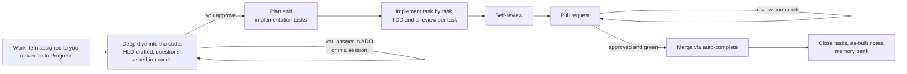

# ASDF: Automated Software Development Workflow

> **Credits.** ASDF is heavily based on two projects, and we're grateful to both.
>
> - **[Superpowers](https://github.com/obra/superpowers)** by Jesse Vincent. ASDF's engine is copied from Superpowers 7.0.0 and adapted for GitHub Copilot and Azure DevOps.
>   - Adapted: brainstorming, writing-plans, subagent-driven-development, executing-plans, requesting-code-review, receiving-code-review, finishing-a-development-branch, using-git-worktrees, and using-asdf (from using-superpowers).
>   - Copied with small edits: test-driven-development, systematic-debugging, verification-before-completion, writing-skills and dispatching-parallel-agents.
>
>   Superpowers is MIT-licensed, and its copyright notice is kept in [LICENSE](LICENSE).
> - **[Superlite](https://github.com/iha2/superlite)**. ASDF borrows two of its ideas: asking questions in batched rounds with a recommended answer for each, and recording the agent's own calls instead of stopping to ask. No Superlite code or text is copied.

ASDF is a plugin for **GitHub Copilot** (the Copilot CLI and the GitHub Copilot app). It takes an **Azure DevOps** work item from assignment to a merged pull request.

It follows the same cycle as Superpowers (design, plan, test-driven implementation, review, finish). What ASDF adds is the steering between those steps:

- You assign a PBI, User Story or Task to yourself and move it to In Progress.
- ASDF drafts a high-level design (HLD), asks the questions it can't settle on its own, and waits for your approval.
- After approval it works on its own. It plans, implements one task at a time with TDD, reviews its own work, opens the PR, handles review comments, and merges.

You step in for three things only: answering the HLD's questions, approving the HLD, and reviewing the PR. Every key decision is recorded in Azure DevOps, along with how it was made. Everything ASDF writes lives in a local context folder, outside your repos.

## How it works



- **Design first.**
  - For each PBI or User Story, ASDF creates an **HLD task** and a **Review task** under it. A Feature gets a breakdown into PBIs instead (see [Large work](#large-work-features-and-their-pbis)).
  - Before drafting, it does a **deep dive** into the code:
    - how it works today;
    - what it can reuse;
    - what depends on what it will change, searched in every workspace you configured;
    - the edge cases the code already handles.

    Every claim cites a file and line.
  - It drafts the HLD from the work item, the deep dive, and the decisions recorded for earlier items in the same repo. The HLD lists what it reuses, what must keep working and the edge cases. Breaking something that works today is always your call, never ASDF's.
  - Questions it can't settle go out in **rounds**. Each round is one ADO comment with a table of multiple-choice questions, ASDF's recommendation listed first.
  - Before asking for approval, a fresh reviewer checks the HLD against the code: anything it reinvents, breaks, misses or gets wrong.
  - The full design, mermaid diagrams included, is attached to the HLD task as markdown.
  - ASDF's comments, and the descriptions it writes in full, are Markdown, with tables for questions, decisions and summaries. A description someone else wrote keeps its format; ASDF never converts it.
  - If the PBI already has an HLD task (tagged `asdf-hld`, or titled `HLD...` or `Design...`), ASDF uses it rather than creating a second one. It drives that design only if the task is assigned to you and this item owns the design. Replies on a shared HLD never authorize ASDF to rewrite it.
- **The approval gate.** Nothing gets built until the HLD is approved. To approve, comment `approved` on the HLD task, or mark the task Done.
- **Hands-off after approval.**
  - ASDF writes the plan and creates the **implementation tasks** under the PBI.
  - Before implementation starts, it reads the repo's README and worktree/
    bootstrap, build and test skills and follows them to make the checkout and
    feature branch. An existing branch for the item, even with commits, is
    adopted rather than recreated. It then records a real baseline build and
    tests once per checkout and reuses it on resume. A red baseline (say the
    default branch itself doesn't build) is recorded as known failures; only
    new failures block.
  - Without README guidance, ASDF makes a short linked worktree from the
    default branch. If that can't be initialized, it uses the configured
    checkout on the item branch from a fetched base the README names
    (`origin/main` or, say, a last-known-good build branch). Uncommitted
    changes are never switched away, reset or stashed.
  - It implements each task with a fresh subagent and reviews it.
  - It runs a self-review: its own reviewer, plus every review skill your repo provides.
  - Then it opens the PR.
- **The PR loop.**
  - ASDF fixes or answers review comments, and fixes builds.
  - Once the PR is approved, the build is green and no comment is left unanswered, ASDF sets auto-complete, and Azure DevOps merges when its policies pass.
  - After the merge, ASDF closes its tasks. It closes the parent too, but only if the parent is yours and all of its child tasks are done.
  - It then adds as-built notes to the HLD and records the HLD and its decisions in a local **memory bank**, which future designs reuse.
- **Changing your mind.** Reopening an approved HLD task stops build work and sends the item back to design. This works until the PR is set to auto-complete. After that, the PR still merges.
- **Single Tasks and Bugs.** ASDF posts a short comment saying whether it treats each one as small or complex.
  - Design tasks and implementation Tasks governed by an already tracked PBI stay in that parent's workflow, not separate branches.
  - **Small** (a few lines, no new interfaces or dependencies, nothing to decide): it goes straight to TDD and a PR, with no HLD and no new work items. Review uses the Task description, and its summary is in the PR rather than a nonexistent Review task.
  - **Complex, with no parent:** ASDF asks you to parent the Task to a PBI or User Story, and waits.
  - **Complex, under a parent with no HLD yet:** ASDF runs the full design flow. The Task becomes the implementation task.
  - **Complex, under a parent that has an HLD:** if the Task fits the approved design, ASDF plans only that Task. Otherwise it proposes changes to the shared HLD's owner and waits; it never edits the parent's design on behalf of a standalone Task.

## Requirements

- GitHub Copilot CLI or the GitHub Copilot app.
- **Node.js 22.18 or later**, installed before you install the plugin, with `node` on your PATH. Check with `node --version`. ASDF's hooks and CLI are TypeScript that Node runs directly, so there's nothing to build and no packages to install.
- git on your PATH.
- Local checkouts of the repos ASDF works on (workspaces), such as `C:\src\Payments`.
  ASDF follows each repo's README for feature branches and checkouts, and
  otherwise creates a short linked worktree. It can also work directly in the
  configured checkout, on a branch under `user/<userName>/`. It never
  searches the disk for repos or clones one.
- **ADO access through MCP when work needs it.** ASDF discovers available tools
  in the running host, including existing local ADO servers and shared services
  that accept an organization parameter. You do not need a new server per org
  or a saved server association to complete init. ASDF uses MCP, never the `az`
  CLI or REST calls.

  The wizard's optional **MCP entries** review menu can prepare a remote entry
  if you want one, but is skipped by default. Runtime errors identify the actual
  org, capability and access failure; unattended runs leave affected items alone.

  If you choose that optional remote setup, the wizard proposes:

  ```json
  "ado-contoso": { "type": "http", "url": "https://mcp.dev.azure.com/contoso", "headers": { "X-MCP-Insiders": "true" }, "tools": ["*"] }
  ```

  The Insiders header enables the remote server's WIQL capability. Existing
  local or host-provided tools need no such entry from ASDF.

## Install

First install [Node.js](https://nodejs.org) 22.18 or later, if `node --version` shows an older version or nothing. Then:

```shell
copilot plugin marketplace add donethree/ASDF     # or a git URL, or the path to a local clone
copilot plugin install asdf@asdf-dev
```

The GitHub Copilot app uses the same plugins as the CLI.

ASDF carries its own copy of the Superpowers engine, so **disable Superpowers and Superlite** while ASDF is enabled. Their skills share names with ASDF's (`brainstorming`, `writing-plans`, ...), and the wrong one could load. Disable them with `/plugin`.

Then run the manual setup command below in a terminal.

## Set up: `node asdf.js --init`

From the plugin directory, run:

```shell
node asdf.js --init
```

Or use an absolute plugin path, for example `node "C:\tools\asdf\asdf.js" --init`.
Setup is **not a skill** and does not use a model, contact ADO, start an MCP server
or sign in. It reads local Git metadata and prepares configuration files only.
Agents and automation tell you to run it manually; they do not launch the wizard.

The numbered wizard explains every input with fictional examples and offers
Add/Edit/Remove/Continue. Organizations, projects, repositories and backlogs
each ask **Add another?** after an accepted entry. Enter one value at a time;
spaces and commas in a path are literal, not separators.

1. **Context folder:** for example `C:\asdf-context`, outside every Git repo.
   A separate prompt collects the **worktree parent folder**, such as `Q:\w`.
   ASDF reserves six-character names there so each newly created worktree's
   complete root path is at most 13 characters. The wizard rejects parents too
   long for that budget. Planning files, logs and sessions stay in the context.
2. **Organizations and projects:** `https://dev.azure.com/contoso/Commerce`
   identifies organization `contoso` and project `Commerce`. Paste the whole
   URL or use the prompt's name form. Registration alone does not watch a project.
3. **Code repositories:** `https://dev.azure.com/contoso/Commerce/_git/Payments`
   identifies repository `Payments`. The next prompt asks where its code is
   **already checked out**, for example `C:\src\Payments`. ASDF checks origin
   locally; it never clones. Browser view parameters such as `?path=/src` or
   `?version=GBmain` do not change the repository identity. You can also start
   with an existing checkout path; editing offers the saved values as defaults.
   Legacy URLs such as
   `https://onedrive.visualstudio.com/SharePoint%20Online/_git/SPO.Core`
   also work: organization `onedrive`, project `SharePoint Online`, repo
   `SPO.Core`. The matching checkout may use either the legacy or dev.azure.com
   spelling of its origin.
4. **Backlogs/project watches:** paste a team URL such as
   `https://dev.azure.com/contoso/Commerce/_backlogs/backlog/Data%20Movement/Features?showParents=false`.
   It selects team `Data Movement` across supported work-item types assigned
   to you. `%20` means a space; `Features` and `showParents=false` are browser
   view settings, not watch restrictions. A project URL selects the whole
   project, with optional individually entered Area Paths.
5. **Work-item types and branch user name:** keep the shown defaults or edit
   them. `jdoe` produces branches such as `user/jdoe/12345-add-export`.
6. **Review, then Save:** nothing is written before confirmation. `:back` returns
   to editing; `:cancel`, Ctrl+C or EOF cancels without saving. Menu **9: MCP
   entries (optional)** can prepare local MCP configuration, but is not part of
   the required questions. Without opting in, init does not inspect, validate,
   create or update `mcp-config.json`. Existing MCP settings stay untouched.

The config is `<context>\asdf.config.json`; its pointer stays in
`~/.copilot/asdf/settings.json`, never `~/.asdf`. Only configs with numeric
`schemaVersion: 2` are supported; version 1 configs are rejected, not migrated.
Projects require explicit `watchScopes`. Custom `workItemTypes` must include
`parent`, `task` and `feature` lists; an empty `feature` list disables Feature discovery.
At least one repo and one watch source are required. Adding a repo does not
subscribe its project, and a backlog does not implicitly choose a code repo.
An org's `mcpServer` is optional. Existing values remain preference hints;
a missing or stale hint does not block runtime discovery of another usable server.

Re-run the same command to edit setup. All valid configuration updates are
allowed, including context, checkout, organization and branch-user changes,
while items are active, waiting or unresolved. Setup does not inspect item
state, restore removed connections, stop workers, release locks or move history.
Existing item records and worktrees keep their recorded values; subsequent
operations use the updated configuration and retain their normal ownership,
repository and branch checks. Setup does not change Git remotes or grant
permissions. Concurrent edits to configuration files involved in the save and
partial write failures are reported. General Copilot preferences are read only
for advisory plugin warnings and do not invalidate your setup draft.

ADO access is exercised during normal intake/do-next and each item worker, not
a separate first-run verification step. Tools are discovered by capability and
their org/project routing is checked through the step's required reads before
writes. Only a genuinely unavailable operation reports an access/capability
problem; no init rerun is required just to supply a server hint. Unattended runs
report problems without asking chat questions. If optional MCP configuration changed,
an already-running Copilot session may need its normal MCP reload.

## Daily use

| You want to | Do this |
|---|---|
| Start work on something | In a session, say "work on PBI 12345" (an id or a URL). If you don't name a Feature, PBI, User Story or Task, ASDF asks for one. It never works without one. |
| Start large work | Name a Feature instead of a PBI. ASDF breaks it into PBIs, each with its own HLD and PR. If you name a PBI that looks too big for one PR, ASDF suggests making it a Feature, and you decide. |
| Answer design questions | Reply on the HLD task, for example `Q1 A, Q2 B` or `go with your recommendations`. Or, in a session: "let's go through the open questions for 12345". |
| Approve the HLD | Post `approved` on the HLD task, or mark that task Done after the request. You can also approve the current version in an interactive session. Conditional approval/change requests require revision. |
| Approve a Feature's breakdown | The same, on its Breakdown task. |
| Start a PBI that waits for another | Move it to In Progress. ASDF's run summary tells you when what it waits for is done. |
| Send a design back | Reopen the HLD task before the PR is set to auto-complete. |
| Review the PR | Review it as usual. ASDF fixes or answers each comment and merges once the PR is approved and green. |
| Unblock an item | Reply to the `[ASDF] Blocked:` comment on it. The next run picks it up. |
| Make progress right now | Run `/asdf:do-next`. |

**Name the package in the work item**, for example `Payments` in its title or description. ASDF matches it to one of your workspaces. If the work item names no package you have a workspace for, ASDF asks: in the first HLD question round for a PBI, or in a comment on a Task.

ASDF only works on a Feature, PBI or User Story while it's **In Progress**. If you start one from a session, ASDF offers to move it there. Every item assigned to you still gets a local folder, so it's ready when you move it.

### What ASDF creates in Azure DevOps

| Item | Title | Tags | When |
|---|---|---|---|
| HLD task | `HLD: <parent title>` | `asdf; asdf-hld` | At pickup. Holds the design attachment, the decisions table and the question rounds. |
| Review task | `Review: <parent title>` | `asdf; asdf-review` | At pickup. Holds the self-review summary. |
| Implementation tasks | `Impl <n>: <step>` | `asdf; asdf-impl` | After HLD approval, one per plan step. |
| Pull request | `<id>: <title>` | | After the self-review. Lists the planning decisions and the self-review results. |
| Feature | the PBI's title | | Only when you agree to make a large PBI a Feature. The PBI goes under it. |
| Breakdown task | `Breakdown: <feature title>` | `asdf; asdf-breakdown` | When ASDF picks up a Feature. Holds the breakdown attachment, the decisions table and the question rounds. |
| A Feature's PBIs | from the breakdown | none | After the breakdown is approved, assigned to you. They're ordinary PBIs, so they carry no ASDF tags. |

**ASDF acts under your name.** Every comment it posts starts with **`[ASDF]`**, which is how it tells its own comments apart from yours. It only posts a fixed set of comments: question rounds, approval requests, answers and approvals given in a session, blockers, task-size and parent requests, Feature splits, HLD updates and proposals, and the final and Feature summaries. It never posts progress updates.

Each decision is recorded with how it was made:

- **Design decisions** (`D1`, `D2`, ...) are listed on the HLD task. Each one is either decided by a person, in a session or an ADO comment, or an ASDF assumption that was approved along with the HLD.
- **Planning decisions** (`P1`, `P2`, ...) are made by ASDF after approval. They're listed in the PR description.

## Large work: Features and their PBIs

Azure DevOps has no level between a PBI and a Task, so large work is a **Feature**, built as one or more **PBIs**. Each PBI gets its own HLD and its own reviewable PR, instead of one very large PR.

- **Name a Feature,** and ASDF goes straight to its breakdown: what the Feature needs, and the PBIs to build it in, in order. For example, "move the subscription files into a database" becomes two PBIs: import the existing data, then move the readers to the new tables.
- **Name a large PBI,** and ASDF checks its size before designing anything. If it would ship as separate steps, or touches more than one repo, ASDF explains why and suggests making it a Feature. You decide. On a yes, ASDF creates the Feature, puts your PBI under it, and parks the PBI until the breakdown is approved. In the hourly run, the suggestion is the only question in the first HLD round. When in doubt, ASDF treats work as not large.
- **The breakdown** works like a lighter HLD: a deep dive into the code across the Feature, then question rounds and approval on the Feature's **Breakdown task**, with every decision recorded. It holds the requirements, the PBIs, and only the decisions that span PBIs. Each PBI's detailed design stays in its own HLD.
- **After approval,** ASDF creates the PBIs the breakdown lists, assigned to you, and starts the ones that wait for nothing. Each one then runs the normal flow, and its HLD starts from the breakdown, so settled questions aren't asked again.
- **You start a PBI that waits for another,** by moving it to In Progress. ASDF never starts it; its run summary tells you when what it waits for is done. That way, for example, you can wait until an import has actually run in production.
- **When every PBI is finished,** ASDF closes the Feature, if it's yours and all its children are complete, and posts a summary.
- **Changing the plan.** Reopening the Breakdown task revises the breakdown. PBIs that have started keep their own HLDs, and ASDF never removes a PBI.

## Interactive continuation

Manually started item work stays in its conversation. When an HLD or Feature
breakdown waits for answers/approval, ASDF registers a **five-minute session
check**, when the host exposes its recurring-prompt tools. You can give feedback
or approve the current design in chat, post `approved` in ADO, or mark the owned
design task Done. Chat approval continues immediately; ADO changes are picked
up by the next check without a separate "continue" prompt.

The same live flow monitors PR feedback, build/check readiness and merge
completion. PR approval still requires real ADO reviewer votes and policy
checks; saying "approved" in chat cannot supply a PR vote. After a Feature
breakdown is approved, ready child PBIs continue one at a time in the same
conversation, with separate HLDs/worktrees/PRs. Dependency-gated Proposed
children still require a person to start them, and other workers' children
are never taken over.

Polling runs only while the host can process this interactive session.
Busy tools/question forms, suspension or closing it may delay ticks. If
scheduling is unavailable or disallowed, ASDF says so instead of installing
a daemon or claiming a check is running. There are no new setup settings.
Unattended do-next (including inline mode), persistent workers and subagents
do not create these live watches.

A 15-minute reservation is renewed only after a complete successful refresh.
It keeps the hourly loop from taking the active live item while waiting, but
expires when checks stop succeeding. Errors do not imply approval or extend
priority forever. The running session can notice restored access without a
manual prompt, but must defer to any worker that acquired the item meanwhile.
Unchanged polls are quiet; decisions/errors use the existing compact log,
never chat bodies or per-check heartbeat noise.

Ask to stop watching to cancel only this thread's watch. Local `live-info -Id`
and `session-info -Id` expose the current wait and expiry; they do not start a
model or polling. Rejoining manually revalidates state and the host schedule
rather than trusting stale chat/schedule IDs.

Approval is version-bound in all modes. Accepted feedback prevents the prior
version from being implemented, even after live priority expires. Later
feedback supersedes an earlier Done transition. ADO comment approvals use
`approved` or `approved, ship it` with optional `.`/`!`; `approved if ...` or
`approved, but change ...` are feedback, not unconditional approval. Shared
designs cannot be approved by proxy. Feature self-ID design fallbacks use
explicit approval, never closing the Feature as a design task.

## The hourly automation (GitHub Copilot app or CLI)

`do-next` makes one pass through every tracked work item. It does all the work it finds, starting with the most-finished:

1. PRs with new comments
2. merges
3. implementation in progress
4. newly approved HLDs
5. new answers to questions
6. new In Progress items

It also refreshes the snapshot of every assigned item. It never asks you anything; questions go to Azure DevOps. It ends with a short summary of what it did and what's waiting on people.

Discovery unions completed, paginated project/team results. Assignment refresh
for already-tracked items is independent of those filters, so removing a watch
does not abandon a running workflow. A failed or incomplete query is unknown,
never evidence of reassignment, and a failed team query is never broadened to
the whole project.

To run it every hour, create the automation in the GitHub Copilot app:

1. Create a new **local** automation, named for example "ASDF do-next".
2. **Trigger:** CRON `0 6-23 * * *`, which runs every hour from 6 am to 11 pm.
3. **Prompt:** `/asdf:do-next sessions` for persistent item conversations, or `/asdf:do-next` for the existing inline behavior.
4. **Project:** a neutral local launch folder. The context folder can serve if the app supports it as a non-Git, in-place project; otherwise use a separate launcher project outside it. Do not initialize Git inside the context folder. The project selection does not grant access to all configured workspaces.
5. Configure tool approvals according to your organization's policy and retain repository branch policies. The guard below is supplementary; it is not a replacement for permissions or server-side enforcement.
6. Choose **Create and run**. Check that the run finishes and prints a `do-next` summary.

Live sessions and automation both lock each item before updating its files or doing work. The owner is retained across handoffs and heartbeats; a competing operation defers the item. A lock goes stale after 90 minutes. If an item gets stuck, ASDF comments on it, marks it Blocked, and moves on. A failed final suite is repaired directly, with at most two attempts before blocking, rather than restarting a completed plan.

### Persistent item conversations

In **sessions** mode, each independent PBI/User Story, standalone Task/Bug, or
Feature breakdown keeps one Copilot CLI session across runs. HLD, Review and
implementation tasks stay in their governing item's conversation. Workers
run sequentially within a pass and reuse ASDF's existing worktrees and ledger.
Bare `do-next` and `do-next inline` keep working in the invoking conversation.
Existing schedules are not rewritten automatically.

Both hosts use the same local CLI backend. Install Copilot CLI on PATH;
ASDF checks for the required session/output options. Version `1.0.103-0` was
used for the create/resume/export compatibility probe, not established as a
minimum supported version. No SDK or additional runtime package is needed.
For CLI scheduling, use `/every 1h /asdf:do-next sessions` while that coordinating
CLI session remains running, or configure an external scheduler yourself.
This hourly interval is not the app's restricted 6 am-11 pm cron schedule.

The child CLI must already have the appropriate normal permissions, configured
ADO MCP server authentication and enabled ASDF skills. App approvals do not
automatically transfer to a child CLI. ASDF never expands access, changes
disabled skills, or bypasses trust/permission checks. A worker infrastructure
failure is reported locally, not turned into an ADO business blocker or
silently retried inline.

**Inspect without intervening:** the automation summary gives the session ID
and paths to `<item>\session\status.md` and `transcript.md`. Status shows current
stage, last activity, waiting reason and ADO target. The transcript is the last
complete export; current-run activity is in `session\runs\<run-id>\events.jsonl`.
Run `node "<plugin root>\scripts\asdf.ts" session-info -Id <id>` for the same
read-only metadata. These files remain after merge and worktree cleanup.
Answers, approvals and PR feedback still belong in ADO.

CLI-created conversations are **not guaranteed to appear as native desktop
sidebar sessions**. The portable viewing surface is these local files.
`copilot --resume <session-id>` opens an active client, not a read-only attachment:
do not attach while a worker runs, and close the inspector before another
scheduled pass. Reading status/transcripts is safe while automation continues.

An unfinished worker excludes competing passes even if its ordinary lock ages.
An uncertain termination reports `recovery-needed`; ASDF does not assume an
old PID or missing heartbeat proves all tools have stopped. For a proven stopped
latest run, `session-recover -Id <id> -RunId <run-id> -Action retry -Reason "<why>"`
keeps its identity; `-Action replace` explicitly archives the old identity and
reserves a new conversation without deleting history. For an interrupted or
uncertain run, first verify that **all descendants have stopped**, then explicitly
add `-ProcessesStopped true` and describe that investigation in `-Reason`.
This acknowledgement is never supplied by automation. Recovery also checks the
recorded host and refuses any known live PID or mismatched run; a missing PID
alone is insufficient. Do not edit or delete run/lock files.

Short operation guards record their owner. A guard from a provably dead local
process is reclaimed without removing a new holder's guard. Foreign-host,
corrupt or unverifiable guards remain explicit maintenance errors.

### Lightweight decision log

The automated loop writes compact operational decisions to
`<asdf-context>\automation-YYYY-MM-DD.log`, directly in the context root.
Dates and timestamps are UTC; the next append selects the current day's file.
Expired files are pruned on append only when their entire UTC day is older
than five days. This may retain today plus five preceding daily files.

The log records selected/tracked work, meaningful state/phase outcomes,
source failures and a final pass summary. An otherwise idle pass gets one
`outcome=no-actionable-work` entry, not an entry for each unchanged waiting item.
An incomplete scan is reported as incomplete, not mistaken for no work.

These are **not session logs**: no prompts, conversations, internal reasoning,
CLI session IDs, source code, raw ADO/tool output, or heartbeat chatter is copied.
Existing per-item transcripts and implementation ledgers remain separate.
Reasons are short operational explanations. Plain-text fields are escaped and
each record is limited to 2 KiB.

Skills use `automation-log -PassId <pass> -Action <action>` on the existing
ASDF CLI. A failed append or cleanup is an observation warning, not a business
blocker; it must not stop work or replay an already successful action. No
logging package, configuration step, background timer or external service is used.

### Execution across repositories

The coordinator may start in one folder and work on items in different configured repositories. Each code worker receives a verified `execution-context.json`: repository identity, original checkout (read-only), item worktree, branch, artifact folder, owner, CLI entry and target-repo instruction files.

Workers use explicit checkout working directories and absolute file paths, load root and applicable nested/scoped repository instructions, and validate edit targets with `code-path`. Build/review CLI helpers reject another repo or branch before running. Code is edited only in the item's recorded checkout; two unfinished items never share one.

This is execution routing and validation, not a shell sandbox. Copilot must still have the appropriate narrowly scoped directory/tool permissions. Missing permissions block work rather than expanding access automatically.

On Windows, use a drive-qualified context/worktree path for shell builds. `task-done` rejects a UNC working directory instead of letting the command shell fall back elsewhere.

## The guard

ASDF installs a `preToolUse` hook. While the plugin is enabled, it blocks these actions in every Copilot session. It checks the shell tools, and MCP tools that run processes, such as Desktop Commander's:

- force-pushing, and pushing to `main` or `master`;
- once setup has saved your user name, pushing to any branch outside `user/<name>/`. That includes a bare `git push` and `git push origin HEAD`, because the guard can't see which branch those reach. Pushing tags is fine;
- `az devops`, `az boards`, `az repos`, `az pipelines` and `az artifacts`;
- web requests to `dev.azure.com` or `*.visualstudio.com`, including `az rest`;
- voting on a pull request, and bypassing branch policies.

To check that it works, ask Copilot to run `echo ASDF-GUARD-SELFTEST`. It should be blocked with an `ASDF guard` reason. Git global options with separate values are parsed before checking push destinations. The guard remains a command-pattern check, not a shell sandbox; retain branch policies and tool permissions. If the guard itself fails, it lets the command through rather than block every shell command.

## Where files go

```
<context>\
  asdf.config.json        orgs, projects, optional MCP hints, work item types, workspaces, user name
  memory\org-<org>\project-<project>\repo-<repo>.md
                         merged items and decisions, isolated by full repository identity
  # Code worktrees are separate: <worktreeRoot>\<six-character-name>
  <id>-<slug>\            one folder per work item, kept after merge
    item.md               snapshot of the work item
    execution-context.json verified execution packet for code workers; refreshed, never treated as a permanent grant
    deep-dive.md          how the code works today, what depends on it, and its edge cases, with file and line
    hld.md                the design; hld.v<N>.md is each version sent to Azure DevOps
    breakdown.md          for a Feature, its breakdown into PBIs (breakdown.v<N>.md likewise)
    questions.md          question rounds and answers
    decisions.md          every decision, with how it was made
    plan.md               the implementation plan
    reviews\              self-review reports
    sdd\ledger.md         implementation progress, so a later run can resume
    session\             persistent CLI binding, current status, last complete transcript and per-run evidence
    state.json            stage, Azure DevOps ids, PR, branch, lock and timestamps
```

Nothing goes into your repos except the code changes on ASDF's branches.

`worktreeRoot` is selected during manual init and used only for new default
worktrees. A checkout made by the repo's own procedure, or an existing branch,
is recorded where it is with `checkout-record`; it only has to hold the item's
repository on a branch under `user/<userName>/`. Location selection
does not grant directory access. Re-run init on an older setup before creating
new worktrees. ASDF will not move or delete your work merely because the root changed.

Use `asdf.ts memory-path -Org <org> -Project <project> -Repo <repo>` for the encoded memory path. Legacy name-only indexes are left in place; an entry is reused only after its linked item's full repository identity is verified. Equal repository names in different projects are supported; use `item-repo -Org ... -Project ... -Name ...` to select one. Equal work-item ids across organizations still report an explicit collision.

## Troubleshooting

- **ASDF doesn't seem active in a session.** Its hooks run on Node.js. Check that `node --version` prints 22.18 or later in a new terminal, and that the plugin is enabled (`/plugin`).
- **"ASDF is not initialized".** Run `node "<plugin root>\asdf.js" --init` manually.
- **The `do-next` summary says "sign-in needed".** Open an interactive Copilot session so that org's Azure DevOps MCP server can sign in (`/mcp`).
- **ADO lookup or WIQL failure.** ASDF first discovers other available tools
  that can target the same org. If none can perform the required operation,
  check the reported server/capability/error. Re-run init only to correct
  org/project/team values or explicitly prepare optional MCP configuration.
  Unsupported team queries are reported without expanding scope.
- **An automation run stops at a permission prompt.** Configure only the required approvals through the host's normal permission controls. In sessions mode, check the child CLI separately; never disable safeguards to make it proceed.
- **A session run fails or is incomplete.** Inspect `session-info`, the run's `stderr.log` and `events.jsonl`. Progress already recorded in state/ledger is preserved; a failed transcript export does not undo completed work.
- **The wrong brainstorming skill runs.** Disable Superpowers or Superlite with `/plugin`.
- **The guard blocks too much, or nothing at all.** Run the self-test above. The guard logs its own errors to `asdf-hooks.log` in your temp folder (`%TEMP%` on Windows).

## Development

- **How it fits together:** [ARCHITECTURE.md](ARCHITECTURE.md) describes the flow, the hooks, the skills and the scripts.
- **Deterministic logic** is TypeScript under `scripts/lib/`, behind the CLI `scripts/asdf.ts`. Node runs it as is, with no build step and no runtime packages:
  - settings, and item state and stages;
  - approval detection, locks and the work queue;
  - repo-skill discovery and the SDD workspace;
  - the guard.
- **Judgment and Azure DevOps calls** live in the skills, under `skills/`.
- **Tests** use Node's built-in test runner:

  ```shell
  npm test
  ```

- **Type checking** needs the dev packages (TypeScript and Node's types) once: `npm install`, then `npm run typecheck`.
- **Skill behavior** is checked with the dry-run scenarios in `tests/scenarios/`. Use `asdf:writing-skills` when you change a skill.

## License

MIT, the same license as Superpowers. See [LICENSE](LICENSE), which also keeps Superpowers' copyright notice.
