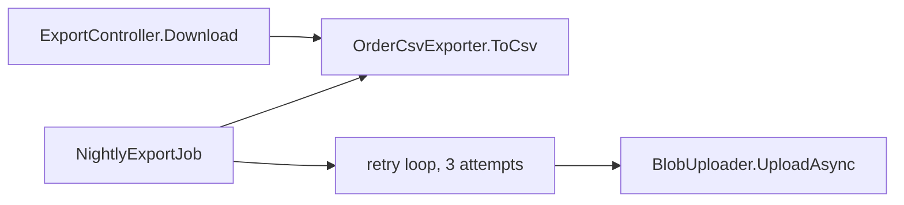

# HLD: Show the currency in the order export (PBI 5100)

Version 1 (draft)

## Intent

Customers outside the US see order totals in the export without a currency, so they can't tell 12.50 EUR from 12.50 USD. The nightly file also goes missing a few times a month, when its upload times out.

## Goals

- The order export shows each order's currency, in the download and in the nightly file.
- A timed-out nightly upload is tried again, so the day's file isn't missing.

## Non-goals

- Converting totals between currencies.
- Changing the download endpoint's URL or file name.

## Constraints

- The export stays a CSV file with a header row, written with the invariant culture.

## Design

1. `OrderCsvExporter` (src/Export/OrderCsvExporter.cs) gets a fifth column, `Currency`, after `Total`. The header becomes `OrderId,Date,Customer,Total,Currency`, and each row writes `order.Currency`.
2. `NightlyExportJob.RunAsync` (src/Jobs/NightlyExportJob.cs) wraps the upload in a retry loop: up to 3 attempts, 5 seconds apart. If the third attempt fails, the exception is thrown as today.

## Package

Orders (workspace `Orders`).

## New dependencies

None.

## Reuse

- `CsvEscaping.Escape` (src/Common/CsvEscaping.cs:6) for the new column.

## What must keep working

- The download endpoint, `GET api/export/{day}` (src/Api/ExportController.cs:14): same URL and file name, now with the extra column.
- The exporter tests (tests/OrderCsvExporterTests.cs). The empty-day test's expected header changes to the new header.

## Edge cases

- Customer names with commas stay quoted.
- A day with no orders is still just the header row.

## Key decisions

| ID | Decision | How it was made |
|---|---|---|
| D1 | Currency goes in a new last column, so the existing columns keep their positions | ASDF assumption |
| D2 | The nightly upload is tried 3 times, 5 seconds apart | ASDF assumption |

## Left to the builder

- Test names and the exact loop code.
